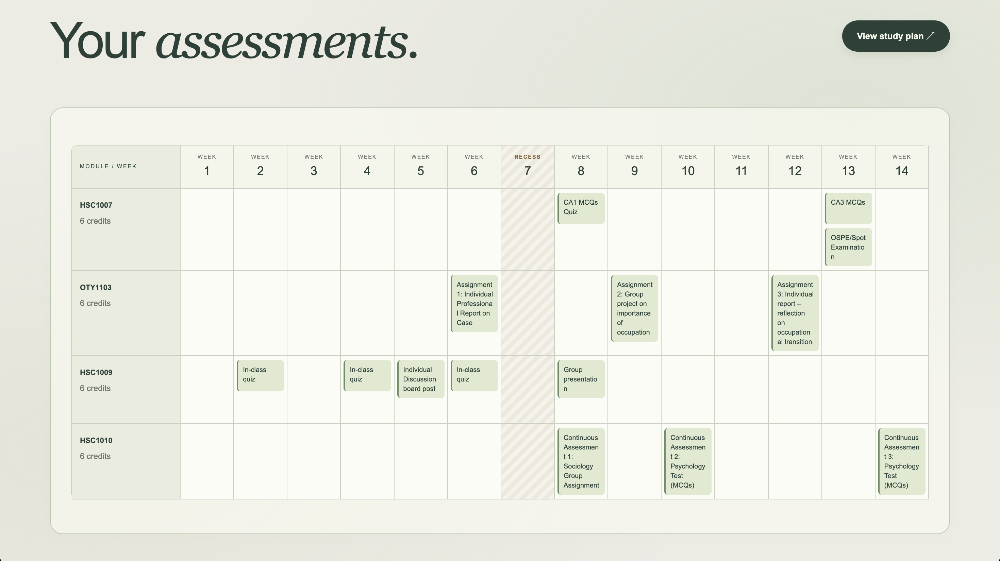
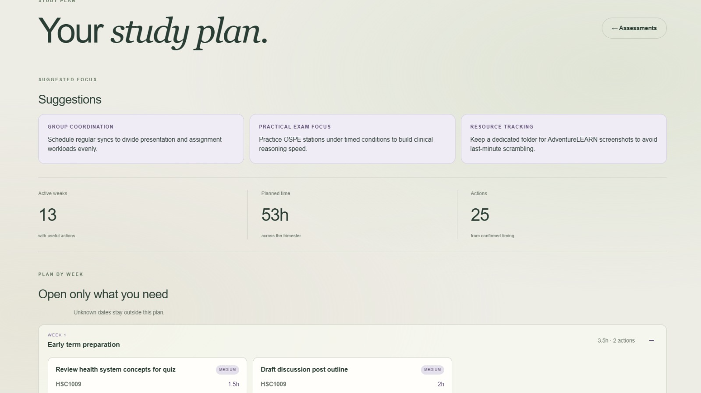
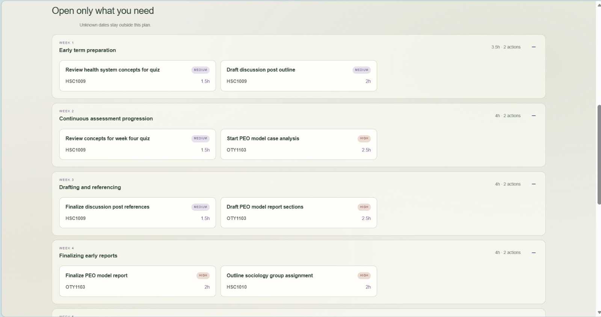

# Stackplan

Stackplan turns module assessment screenshots into a clear Week 1–14 workload
overview and an AI-generated study plan. It is a school project demonstrating a
complete DevOps workflow: multimodal extraction, deterministic scheduling,
PostgreSQL storage, a small HTTP API, a responsive frontend, Docker deployment
and automated tests.

It is designed for students who receive assessment information across several
module screenshots and need one reliable trimester view. The core problem is
not simply displaying those screenshots: Stackplan uses AI to interpret vague
or inconsistent assessment wording, then applies local rules so uncertain
dates and weights are never presented as confirmed facts.

## Project preview

<p align="center">
  
</p>

<p align="center"><em>A single Week 1–14 view makes assessment timing and workload clusters easy to spot.</em></p>

<p align="center">
  
  
</p>

<p align="center"><em>Validated assessments are turned into focused, week-by-week study actions.</em></p>

## Features

- Upload one or more assessment screenshots for each module.
- Use Qwen in separate interpretation and normalization passes.
- Preserve uncertain information as comments instead of inventing facts.
- Place validated assessments into a Week 1–14 timetable.
- Rank workload using module credits and known assessment weights.
- Automatically generate workload highlights and a trimester study plan after
  scheduling.
- Keep Week 7 clear as recess unless source evidence explicitly schedules an
  assessment there.
- Store projects, complete pipeline results, errors and recommendations in
  PostgreSQL.
- Continue with usable modules when another module cannot be processed.
- Run the complete application with Docker Compose.

## How it works

Both HTTP uploads and the CLI call `src/application/planning_service.py`.
Each run owns its `ProcessingContext` and temporary evidence. The service
coordinates four managers and returns the existing `payload` / `errors` JSON
contract, including usable partial results.

| Boundary | Main collaborators |
| --- | --- |
| IO Manager | `SubmissionValidator`, run-owned `EvidenceStore`, `ResultPresenter` |
| AI Manager | `QwenClient`, `RequestBuilder`, response parser/validator, interchangeable advice generators |
| Logic Manager | `ModuleNormalizer`, `ScheduleBuilder`, `ImportanceRanker`, `RecommendationValidator` |
| Data Manager | `PlanningRepository`, `PostgresRepository`, `ResultSerializer` |

Domain objects own assessment identity, timing, weight scope, immutable module
collections, schedule appearances and validated study tasks. Explicit weeks,
unknown dates, Week 7 recess and global importance ranking retain their existing
meaning. SQL remains behind the repository; the existing PostgreSQL JSONB schema
and saved payloads remain readable without migrations.

See [refactor contracts and OOP evidence](docs/REFACTOR.md) for the implemented
UML, exception policy, verification evidence and remaining adapter migration.

## Repository structure

```text
src/domain/          assessment, timing, module, schedule and study-plan objects
src/application/     shared workflow and per-run results
src/*_manager/       four manager packages and focused collaborators
helpers/             HTTP API and Docker payload adapter
frontend/            independent Flask presentation layer
database/            PostgreSQL schema and ignored persistent runtime data
tests/function/      focused manager tests
tests/workflow/      pipeline, API and database workflow tests
tests/frontend/      frontend contract and browser checks
grader-test-case/    easy-to-find live JSON inputs and assessment images
scripts/run_local_unix.sh macOS and Linux local launcher
scripts/run_local_windows.ps1 Windows local launcher
compose.windows.yaml Windows-safe PostgreSQL storage override
tests/deployment/compose.yaml isolated verification stack
compose.yaml         development application services
```

## Requirements

- Docker with Docker Compose 2.24 or newer
- PowerShell 5.1 or newer on Windows, with Docker Desktop using Linux containers
- A DashScope API key for live extraction only; automated verification needs none
- Python 3.12 for development outside Docker
- Node.js 22 or newer for local JavaScript checks

## Configure the environment

Create the local environment file on macOS or Linux (the launcher also does
this automatically when the file is missing):

```sh
cp .env.example .env
```

On Windows PowerShell:

```powershell
Copy-Item .env.example .env
```

Open `.env` and set:

```text
DASHSCOPE_API_KEY=your-key
```

`DASHSCOPE_BASE_URL` and the local database values already have suitable
defaults. Compose reads `.env` automatically; credentials do not need to be
placed in a command or copied into an image.

## Run the complete project

### Teacher quick start with Docker Compose

After creating `.env` and adding `DASHSCOPE_API_KEY`, start the complete web
application on macOS or Linux with:

```sh
docker compose up --build
```

On Windows PowerShell, include the Windows storage override:

```powershell
docker compose --file compose.yaml --file compose.windows.yaml up --build
```

Compose builds and starts the frontend, API and PostgreSQL database. Open
<http://127.0.0.1:5173> when the services are ready. The command does not run a
sample pipeline automatically; processing starts only when a user submits
modules through the browser or explicitly runs the CLI service. Press `Ctrl+C`
to stop the services. Saved database data is kept.

After the images have been built once, `docker compose up` is sufficient unless
the source code or dependencies have changed.

### Convenience launchers

The launchers perform Docker checks, create `.env` when it is missing, wait for
the services to become ready, and show the application logs. On macOS or Linux:

```sh
./scripts/run_local_unix.sh
```

On Windows, open PowerShell in the repository and run:

```powershell
powershell.exe -NoProfile -ExecutionPolicy Bypass -File .\scripts\run_local_windows.ps1
```

The execution-policy override applies only to that PowerShell process; it does
not change the machine or user policy.

Incoming browser and API requests are shown in the terminal. The API and
frontend do not poll one another. Their `/health` endpoints remain available
for an explicit diagnostic check without filling the logs.

On the first run, either launcher creates `.env` from `.env.example` when it is
missing, and PostgreSQL applies `database/schema.sql`. On macOS and Linux,
PostgreSQL files are kept in `database/data/`. Windows uses a Docker-managed
named volume because PostgreSQL data directories require Unix ownership and
permissions that Windows host folders do not reliably provide. Both storage
options survive container replacement.

To use a different frontend port:

```sh
FRONTEND_PORT=5174 ./scripts/run_local_unix.sh
```

On Windows PowerShell:

```powershell
$env:FRONTEND_PORT = "5174"
powershell.exe -NoProfile -ExecutionPolicy Bypass -File .\scripts\run_local_windows.ps1
```

## Run the pipeline from the command line

The `stackplan-cli` service is intentionally excluded from `docker compose up`
and has no default input. It runs only when explicitly given a payload.

The small live example processes one module and consumes Qwen tokens:

```sh
docker compose run --rm stackplan-cli /input/grader-test-case/one-module.json
```

The supplied four-module example can be run with:

```sh
docker compose run --rm stackplan-cli \
  /input/grader-test-case/all-modules.json
```

To process a payload stored elsewhere, the adapter copies its referenced
images into a temporary Docker-readable directory:

```sh
python -m helpers.docker_cli path/to/payload.json \
  --project-name "Trimester 1" \
  --output stackplan-result.json
```

## Run with local Python

Create a development environment and install the project dependencies:

```sh
python3.12 -m venv .venv
source .venv/bin/activate
python -m pip install -r requirements-dev.txt
```

Run the manager pipeline directly:

```sh
python -m src.main grader-test-case/one-module.json
```

Direct execution reads `.env`. Without `DATABASE_URL`, the pipeline still
returns a result but skips PostgreSQL persistence. Docker Compose is the
recommended way to demonstrate the complete system.

## Run the tests

Install `requirements-dev.txt` in your development environment, then use the
same gate as GitHub Actions:

```sh
sh tests/run.sh fast   # static checks, offline Python and JavaScript tests
sh tests/run.sh full   # also all tests in Docker, real PostgreSQL and app smoke
```

Windows: `.\tests\run.ps1 -Group fast` or `-Group full`. The equivalent portable
entry point is `python tests/verify.py fast|full`. No argument defaults to full.
The gate never reads `.env`, calls Qwen or mounts development data. It returns a
nonzero status on required failures, cleans disposable containers and writes
JUnit, coverage, logs and a JSON summary to ignored `test-results/`.

GitHub Actions runs the same checks in order: offline → PostgreSQL/container
tests → application smoke. A fast pass is not a full pass. See
[tests/README.md](tests/README.md) for isolation, coverage floors and troubleshooting,
or [GRADER_TEST_GUIDE.md](GRADER_TEST_GUIDE.md) for assessment commands.

## Inspect or export saved data

Start only PostgreSQL when the application services are not needed:

```sh
docker compose up --detach --wait database
```

Open PostgreSQL's command-line interface using the configured container
credentials:

```sh
docker compose exec database sh -c \
  'psql -U "$POSTGRES_USER" -d "$POSTGRES_DB"'
```

Useful commands inside that interface are `\dt` to list tables, `\d projects`
to inspect one table, and `\q` to exit. A desktop client such as pgAdmin,
DBeaver or TablePlus can also be added later by publishing PostgreSQL's port;
the default Compose setup keeps that port private to the application network.

Export a portable SQL backup without reading PostgreSQL's binary files:

```sh
docker compose exec database sh -c \
  'pg_dump -U "$POSTGRES_USER" "$POSTGRES_DB"' > stackplan-backup.sql
```

The files below `database/data/` are the live database storage. PostgreSQL reads
and writes them through the bind mount; they should never be edited manually.
