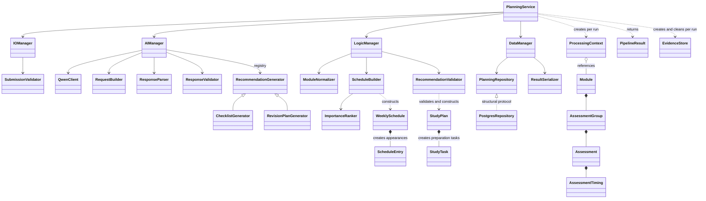

# OOP refactor: contracts and assessment evidence

This refactor keeps the four managers and existing UI, payload/errors responses,
assessment identifiers, Qwen prompts/models and PostgreSQL JSONB storage. It adds
no upload, correction, reprompting or revision-history product features.

## Layers and ownership

Presentation (`src/main.py`, `helpers/api_helper.py`, `frontend/`) receives input
and renders results. Both processing entry points call `PlanningService`.
Validation/application coordinates intake, structural AI validation, domain
planning and storage. Domain objects have no Flask, provider SDK, environment,
terminal or database dependencies. Data access owns SQL and serialization.

Immutable values detach nested metadata and expose tuples or copied records.
Assessments own identity, occurrence invariants and comparable importance;
timing owns supported placements and preserves raw source wording. Groups keep
totals separate from individual weights. Schedules own generated appearances;
ranking happens once per canonical assessment before ranges create copies.
Study tasks distinguish recommended preparation weeks from unknown dates.

A fresh context owns issues, stage, processed module references and persistence
IDs. Injected managers hold collaborators/configuration, never run payloads or
errors. Evidence stores own copies only; both CLI sources and HTTP uploads are
borrowed and cleaned by their respective owners.

## Contracts and SOLID evidence

- `RecommendationGenerator.generate(transport, project, preferences)` is async,
  returns a parsed object or raises a validation/transport error. Checklist and
  revision implementations own different prompts and response shapes. The AI
  manager dispatches a registry, so another implementation requires no workflow
  branch. Shared tests protect substitutability, success and failure behaviour.
- `PlanningRepository` defines the persistence behaviour consumed by managers.
  The same repository contract tests exercise PostgreSQL and a deterministic
  memory double. Consumers depend on the protocol, not SQL.
- Focused validators, transport, normalization, ranking and serializers give each
  collaborator one reason to change. Prompt edits do not change scheduling or SQL.
- `PipelineResult` owns an immutable snapshot and exposes the existing JSON
  shape. Outcome is failed without a payload, partial with issues, otherwise
  completed. Advisory failure preserves the factual schedule.

## Compatibility and failure policy

No physical schema or version change is required. The serializer preserves raw
legacy documents, extra fields, unknown values and saved schedules; typed readers
supply established defaults for absent optional fields without writing them back.
Result and automatic advice persistence commit in one transaction. The latest
non-null result survives newer failed/running runs. Concurrent recommendation
acceptance locks the project to prevent two accepted candidates of one type.

| Condition | Boundary/type | Outcome |
| --- | --- | --- |
| Invalid metadata/evidence | SubmissionValidator/EvidenceStore, readable IO errors | Usable evidence/modules continue; none means failure |
| Source uncertainty | Timing and normalization metadata | Unscheduled facts/follow-ups; no invented week or weight |
| Transport or invalid model structure | AITransportError / ResponseValidationError | Isolate module/advice, close owned client, retain diagnostics |
| Invalid domain state/advice | DomainError / ValueError | Reject invalid state; keep unrelated modules or factual schedule |
| Database unavailable/transaction failure | DataManagerError | Roll back incomplete update; preserve response payload with issue |
| Pipeline timeout | asyncio timeout at application boundary | Controlled failed/partial result; cancellation closes clients and evidence |
| Unexpected defect | Explicit module/application/HTTP boundary, logged traceback | Visible failure/issue; HTTP returns consistent JSON without diagnostics |

The HTTP subprocess path is removed. Framework errors, including malformed
requests, use payload/errors JSON. No required check is converted into a skip.

## Verification and remaining migration

The refactor passes the full local quality gate: 138 offline Python tests,
149 Python tests in Docker with zero skips, 10 JavaScript tests on the host and
in Docker, and application readiness and database round-trip smoke checks.
Docker statement-and-branch coverage is 82.96%. See ignored `test-results/`
reports for the detailed evidence from each verification run.

Transitional function adapters remain in manager `__init__.py` files for existing
scripts/tests and HTTP CRUD calls. They delegate to the implemented classes;
the main planning path uses injected managers and domain objects. Remove adapters
only after their callers migrate, preserving external imports until then. Input
prototype normalization still uses dictionaries as a conversion boundary.

Live Qwen accuracy and a manual interactive browser run remain outside automated
verification. Normal checks use fake AI providers and consume no API credits.
Container smoke checks validate local readiness. GitHub Actions runs the same
underlying entry points after pushes and pull requests; it does not deploy.
